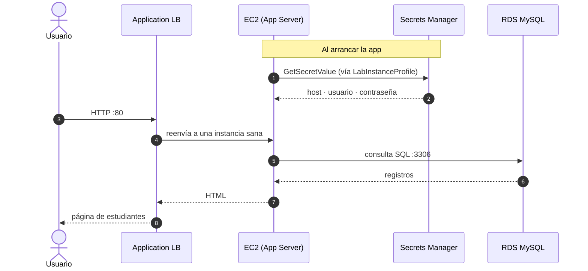
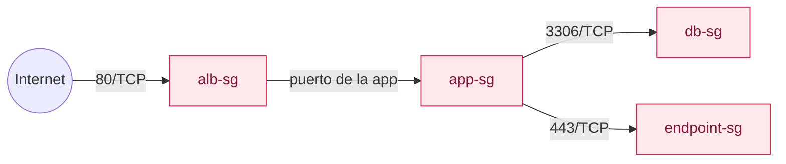
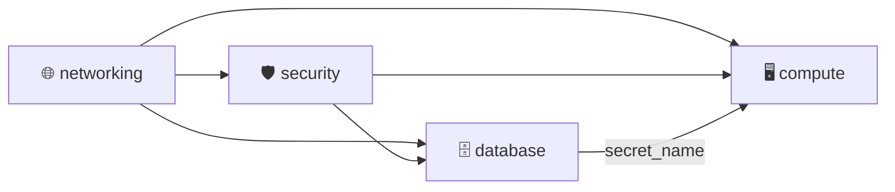
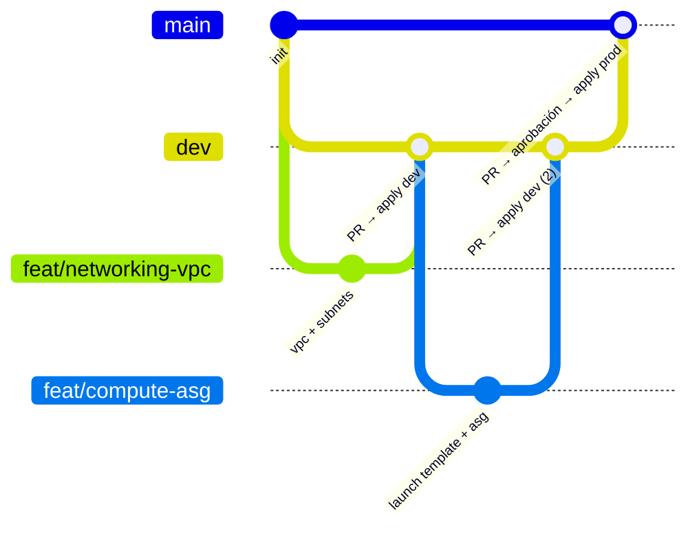

<div align="center">

# 🎓 XYZ University · Infraestructura en AWS

**Aplicación web de registros estudiantiles: altamente disponible, escalable y segura, desplegada 100 % con Terraform y GitHub Actions.**


[Arquitectura](#-arquitectura) ·
[Estructura](#-estructura-del-repositorio) ·
[Ambientes](#-ambientes-dev-y-prod) ·
[CI/CD](#-cicd) ·
[Equipo](#-equipo-y-responsabilidades) ·
[Cómo trabajar](#-cómo-trabajar) ·
[Roadmap](#-roadmap)

</div>

---

## 📌 Contexto

Durante el periodo de admisiones, la aplicación de registros estudiantiles de **Example University** se vuelve lenta o deja de responder por el volumen de consultas. Este proyecto es una **prueba de concepto (POC)** que lleva esa aplicación a AWS con una arquitectura alineada al **AWS Well-Architected Framework**. Los usuarios pueden **ver, agregar, modificar y borrar** registros de estudiantes sin demoras perceptibles, incluso en picos de carga.

> [!NOTE]
> El código de la aplicación (Node.js) **ya existe y no se modifica**. Este repositorio contiene únicamente la **infraestructura como código**, los **pipelines** y la **documentación**.

### Requisitos de la solución

| | Requisito | Cómo lo cumplimos |
|:--:|---|---|
| ⚙️ | **Funcional**: CRUD sin demoras | App Server en EC2 conectado a RDS MySQL |
| ⚖️ | **Balanceo de carga** | Application Load Balancer en 3 zonas de disponibilidad |
| 📈 | **Escalable** | Auto Scaling Group con política *target tracking* por CPU |
| 🛟 | **Alta disponibilidad** | Instancias repartidas en 3 AZ + *health checks* del ELB |
| 🔒 | **Seguro** | BD en subnets privadas, SGs encadenados por referencia, credenciales en Secrets Manager |
| 💰 | **Costo optimizado** | 1 NAT Gateway, instancias `t3.micro`, ambiente dev efímero |
| 🚀 | **Alto rendimiento** | Prueba de carga con evidencia de escalado automático |

---

## 🏗 Arquitectura

<p align="center">
  
</p>

<sub>📎 También hay una versión interactiva (zoom, búsqueda y trazado de relaciones) generada con archify desde <a href="docs/diagramas/arquitectura.json"><code>arquitectura.json</code></a>. El HTML no se versiona: se regenera localmente.</sub>

### Recorrido de una petición



### Red

La VPC se reparte en **3 zonas de disponibilidad** con **9 subnets** en tres capas:

| Capa | Subnets | Qué vive ahí | Salida a internet |
|---|---|---|---|
| 🌐 **Pública** | `public 1` · `public 2` · `public 3` | ALB, NAT Gateway (solo en `public 1`) | Directa por el Internet Gateway |
| 🖥 **App (privada)** | `private 1` · `private 2` · `private 3` | Instancias EC2 del Auto Scaling Group | Solo saliente, por el NAT |
| 🗄 **Datos (privada)** | `private 4` · `private 5` · `private 6` | RDS MySQL (Single-AZ en `private 4`) + DB Subnet Group | ❌ Ninguna |

### Cadena de seguridad



Cada Security Group solo acepta tráfico **del SG anterior**, nunca por rangos de IP. El puerto 3306 **jamás** se abre a `0.0.0.0/0`.

---

## 📁 Estructura del repositorio

```
xyz_university/
├── .github/
│   ├── workflows/
│   │   ├── ci.yml                  # Validaciones en cada Pull Request
│   │   ├── cd.yml                  # Despliegue a dev / prod según la rama
│   │   └── destroy.yml             # Destrucción manual de un ambiente
│   ├── CODEOWNERS                  # Revisor automático según la carpeta
│   └── pull_request_template.md
│
├── terraform/
│   ├── networking/                 # VPC, subnets, IGW, NAT, rutas, VPC endpoint
│   ├── security/                   # Security Groups + LabRole / LabInstanceProfile
│   ├── compute/                    # Launch Template, ALB, Target Group, ASG
│   │   └── templates/
│   │       └── user_data.sh.tftpl  # Arranque de las instancias
│   ├── database/                   # DB Subnet Group, RDS MySQL, secreto
│   ├── bootstrap/                  # Bucket S3 del estado remoto (se aplica una vez)
│   │
│   ├── main.tf                     # Conecta los 4 módulos
│   ├── variables.tf                # Variables que cambian entre ambientes
│   ├── outputs.tf                  # URL del ALB, endpoint de RDS, etc.
│   ├── providers.tf                # Provider AWS + default_tags
│   ├── versions.tf                 # Versiones fijas de Terraform y del provider
│   ├── backend.tf                  # Backend S3 (se completa por ambiente)
│   ├── dev.tfvars                  # 🟢 Valores de dev
│   ├── prod.tfvars                 # 🔴 Valores de prod
│   ├── dev.s3.tfbackend            # Ubicación del estado de dev
│   └── prod.s3.tfbackend           # Ubicación del estado de prod
│
├── scripts/
│   └── smoke-test.sh               # Verifica HTTP 200 en el ALB tras cada apply
│
├── docs/
│   ├── arquitectura.md             # Decisiones de diseño
│   ├── matriz-de-puertos.md        # Reglas de los Security Groups
│   ├── diagramas/                  # SVG animados + fuente .json de la versión interactiva
│   └── evidencias/                 # Capturas de CRUD, escalado y prueba de carga
│
├── SPECS.md                        # Especificación original del proyecto
└── README.md
```

### Módulos

Cada carpeta dentro de `terraform/` es un **módulo** con la misma forma (`main.tf`, `variables.tf`, `outputs.tf`, `README.md`). Terraform **no** lee subcarpetas por sí solo: el `main.tf` raíz las llama y las conecta entre sí.

| Módulo | Qué crea | Documentación |
|---|---|---|
| 🌐 `networking` | VPC, 9 subnets, Internet Gateway, NAT Gateway, tablas de ruteo, VPC Endpoint de Secrets Manager | [README](terraform/networking/README.md) |
| 🛡 `security` | `alb-sg`, `app-sg`, `db-sg`, `endpoint-sg`, `poc-sg`, lectura de `LabInstanceProfile` | [README](terraform/security/README.md) |
| 🖥 `compute` | Launch Template, ALB, Target Group, Listener, Auto Scaling Group, POC de la Fase 2 | [README](terraform/compute/README.md) |
| 🗄 `database` | DB Subnet Group, RDS MySQL, secreto en Secrets Manager | [README](terraform/database/README.md) |

Las dependencias van **en un solo sentido**, así nunca hay ciclos:



---

## 🌗 Ambientes dev y prod

Los dos ambientes usan **el mismo código** y solo cambian los **valores** y el **estado**:

```bash
cd terraform

# dev
terraform init  -backend-config=dev.s3.tfbackend -reconfigure
terraform plan  -var-file=dev.tfvars

# prod
terraform init  -backend-config=prod.s3.tfbackend -reconfigure
terraform plan  -var-file=prod.tfvars
```

> [!IMPORTANT]
> Cada ambiente tiene **su propio archivo de estado** (`dev/terraform.tfstate` y `prod/terraform.tfstate`). Un `apply` en dev nunca puede tocar prod. Por eso nunca se usa `-var-file=prod.tfvars` con el backend de dev ni al revés: el pipeline se encarga de combinarlos bien.

| Variable | 🟢 dev | 🔴 prod | Por qué |
|---|---|---|---|
| `environment` | `dev` | `prod` | Prefijo de nombres y tags |
| `vpc_cidr` | `10.10.0.0/16` | `10.20.0.0/16` | Sin traslape entre ambientes |
| `instance_type` | `t3.micro` | `t3.micro` / `t3.small` | dev no necesita capacidad |
| `asg_min` / `desired` / `max` | 1 / 1 / 2 | 2 / 3 / 6 | prod cubre 3 AZ y picos |
| `cpu_target` | 70 % | 50 % | prod escala antes |
| `db_instance_class` | `db.t3.micro` | `db.t3.micro` | Suficiente para la POC |
| `db_backup_retention_days` | 0 | 7 | Respaldos solo en prod |
| `db_deletion_protection` | `false` | `true` | Evita borrar prod por accidente |
| `db_skip_final_snapshot` | `true` | `false` | Snapshot final solo en prod |
| `enable_secrets_endpoint` | `false` | `true` | El endpoint cobra por hora; dev usa el NAT |
| `enable_poc` | `true` (Fase 2) | `false` | La EC2 única solo existe en dev |

**Convención de nombres:** `xyz-<ambiente>-<recurso>[-<az>]`, por ejemplo `xyz-dev-vpc` o `xyz-prod-app-1a`.
**Tags automáticos** (`default_tags`): `Project = "xyz-university"`, `Environment`, `ManagedBy = "terraform"`.

---

## 🔄 CI/CD

<p align="center">
  
</p>

<sub>📎 Versión interactiva: se genera desde <a href="docs/diagramas/cicd.json"><code>cicd.json</code></a>.</sub>

| Workflow | Se dispara con | Qué hace |
|---|---|---|
| **`ci.yml`** | Pull Request hacia `dev` o `main` | `terraform fmt -check` → `init` → `validate` → `tflint` → `checkov` → `plan` del ambiente destino, y publica el plan como comentario en el PR. Si algo falla, el PR no se puede mergear. |
| **`cd.yml`** | Push a `dev` → **dev** · Push a `main` → **prod** | `terraform apply` con el `.tfvars` y el `.tfbackend` del ambiente, luego `smoke-test.sh`. prod requiere **aprobación manual** en el environment de GitHub. `concurrency` impide dos applies al mismo tiempo. |
| **`destroy.yml`** | Manual (`workflow_dispatch`) | Destruye el ambiente elegido. Pide escribir su nombre para confirmar. |

### Credenciales de AWS Academy

El Learner Lab entrega **credenciales temporales** y no permite crear roles ni usar OIDC, así que:

1. Las credenciales se guardan como **secrets de cada environment** de GitHub (`dev` y `prod`):
   `AWS_ACCESS_KEY_ID` · `AWS_SECRET_ACCESS_KEY` · `AWS_SESSION_TOKEN`
2. Se **actualizan al iniciar cada sesión** del lab, antes de hacer merge.
3. Las instancias usan el **`LabInstanceProfile`** existente (Terraform lo **lee**, no lo crea).

> [!WARNING]
> Si se excede el presupuesto del lab, **la cuenta se desactiva y se pierde todo**. El NAT, el ALB, RDS y el VPC endpoint cobran por hora aunque nadie use la app. **Corre `destroy.yml` sobre dev al terminar cada sesión.**

---

## 👥 Equipo y responsabilidades

| Área | Responsable | Carpetas |
|---|---|---|
| 🌐 Networking · 🛡 Security · 🔄 CI/CD | Santiago | `terraform/networking/` · `terraform/security/` · `terraform/bootstrap/` · `.github/` |
| 🖥 Compute | _por asignar_ | `terraform/compute/` |
| 🗄 Database | _por asignar_ | `terraform/database/` |
| 🤝 Compartido | Los tres | `terraform/*.tf` · `terraform/*.tfvars` · `docs/` |

`CODEOWNERS` asigna automáticamente al revisor según la carpeta que se modifica. Los archivos compartidos requieren la revisión de al menos otra persona.

### Contratos entre módulos

Antes de escribir recursos se acuerdan las **entradas y salidas** de cada módulo. Así cada quien trabaja en paralelo sin esperar al otro:

| Módulo | Expone (`outputs`) | Lo consume |
|---|---|---|
| `networking` | `vpc_id` · `vpc_cidr` · `public_subnet_ids` · `app_subnet_ids` · `data_subnet_ids` | security · compute · database |
| `security` | `alb_sg_id` · `app_sg_id` · `db_sg_id` · `endpoint_sg_id` · `poc_sg_id` · `instance_profile_name` | networking · compute · database |
| `database` | `db_endpoint` · `db_name` · `secret_name` · `secret_arn` | compute |
| `compute` | `alb_dns_name` · `target_group_arn` · `asg_name` | outputs raíz · smoke test |

---

## 🛠 Cómo trabajar

### Requisitos locales

| Herramienta | Versión | Para qué |
|---|---|---|
| [Terraform](https://developer.hashicorp.com/terraform/install) | ≥ 1.10 | Infraestructura |
| [AWS CLI](https://docs.aws.amazon.com/cli/latest/userguide/getting-started-install.html) | v2 | Credenciales y scripts |
| [TFLint](https://github.com/terraform-linters/tflint) | última | Lint local (opcional) |
| [Checkov](https://www.checkov.io/) | última | Escaneo de seguridad local (opcional) |

### Flujo de ramas



1. **Crea una rama desde `dev`:** `feat/<módulo>-<tema>` o `fix/<módulo>-<tema>` (ej. `feat/networking-nat`).
2. **Haz commits pequeños** con mensajes claros: `networking: agrega NAT Gateway en public 1`.
3. **Valida localmente** antes de subir:
   ```bash
   cd terraform
   terraform fmt -recursive
   terraform validate
   ```
4. **Abre un PR hacia `dev`.** CI corre las validaciones y comenta el `plan`.
5. **Revisa el plan** con tu revisor: confirma que no destruye nada inesperado (por ejemplo `-/+` sobre RDS).
6. **Merge a `dev`** → se despliega en dev automáticamente.
7. Cuando dev está estable, **PR de `dev` a `main`** → aprobación manual → se despliega en prod.

### Reglas del equipo

- ✅ Todo cambio entra por **Pull Request**, también hacia `dev`.
- ✅ Nadie hace `terraform apply` manual contra los ambientes oficiales: **solo el pipeline**.
- ✅ Las pruebas manuales van en la **cuenta personal** de cada quien, con estado local, y se destruyen al terminar.
- ✅ Se corre `destroy.yml` sobre dev al cerrar cada sesión de trabajo.
- ❌ Nunca se suben `*.tfstate`, `.terraform/` ni credenciales.

### Primera vez: estado remoto

El bucket S3 del estado se crea **una sola vez por cuenta** desde `terraform/bootstrap/`:

```bash
cd terraform/bootstrap
terraform init
terraform apply
```

Después se coloca el nombre del bucket en `dev.s3.tfbackend` y `prod.s3.tfbackend`. El bloqueo del estado usa `use_lockfile = true` (nativo de S3), sin DynamoDB.

---

## 🗺 Roadmap

Las fases siguen el [`SPECS.md`](SPECS.md).

- [ ] **Fase 0 · Base**
  - [x] Estructura del repositorio
  - [ ] Contratos entre módulos (`variables.tf` / `outputs.tf`)
  - [ ] Bootstrap del estado remoto
  - [ ] Workflow de CI
- [ ] **Fase 1 · Diseño y costos**
  - [x] Diagrama de arquitectura
  - [ ] Estimación con AWS Pricing Calculator (12 meses, us-east-1)
- [ ] **Fase 2 · Aplicación funcional en una sola VM**
  - [ ] VPC y subnets públicas
  - [ ] EC2 POC con la aplicación y la base de datos local
  - [ ] Prueba CRUD por la IP pública
- [ ] **Fase 3 · Desacoplar componentes**
  - [ ] Subnets privadas en 3 AZ
  - [ ] RDS MySQL + Security Groups
  - [ ] Secreto en Secrets Manager
  - [ ] Nueva instancia del App Server
  - [ ] Migración de datos de la POC a RDS
- [ ] **Fase 4 · Alta disponibilidad y escalabilidad**
  - [ ] Application Load Balancer
  - [ ] Launch Template + Auto Scaling Group
  - [ ] Workflow de CD + smoke test
  - [ ] Prueba de carga con evidencia de escalado
  - [ ] Prueba de alta disponibilidad (terminar una instancia)

---

## 📚 Referencias

- [`SPECS.md`](SPECS.md): especificación completa del proyecto
- [AWS Well-Architected Framework](https://aws.amazon.com/architecture/well-architected/)
- [Terraform AWS Provider](https://registry.terraform.io/providers/hashicorp/aws/latest/docs)
- [Backend S3 de Terraform](https://developer.hashicorp.com/terraform/language/backend/s3)
- [GitHub Actions: environments](https://docs.github.com/actions/deployment/targeting-different-environments/using-environments-for-deployment)
- [AWS Pricing Calculator](https://calculator.aws/)

<div align="center">
<sub>Proyecto de DSE · Infraestructura como código</sub>
</div>
