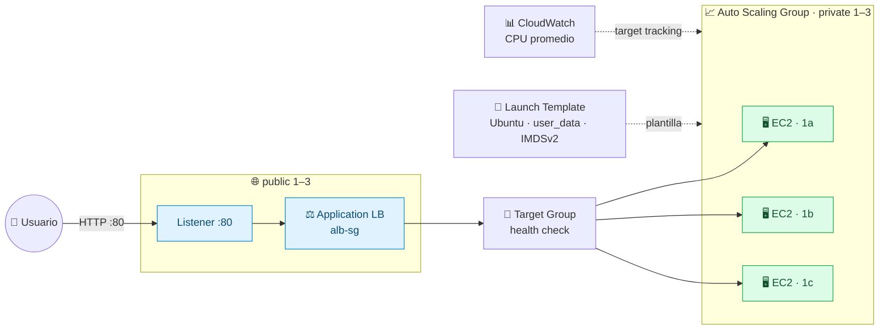
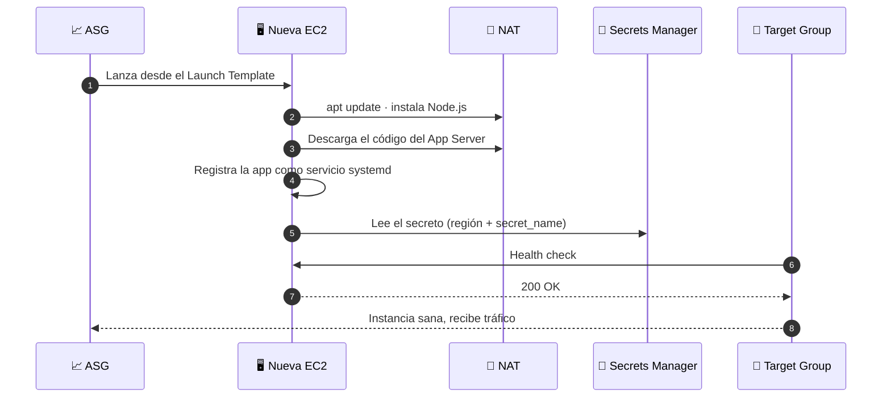

<div align="center">

# 🖥 Módulo `compute`

**El App Server detrás de un Application Load Balancer, en un Auto Scaling Group que crece con la demanda y se repara solo.**


[⬅ Volver al README principal](../../README.md)

</div>

---

## 🎯 Propósito

Corre la aplicación Node.js de registros estudiantiles y la mantiene **disponible y escalable**:

- ⚖️ El **ALB** reparte el tráfico entre instancias sanas de 3 zonas de disponibilidad.
- 📈 El **Auto Scaling Group** agrega instancias cuando sube la CPU y las quita cuando baja.
- 🛟 Si una instancia falla su *health check*, el ASG la **reemplaza automáticamente**.
- 🧪 Opcionalmente, una **EC2 única (POC)** para la Fase 2 del proyecto.

Cubre las fases 2 y 4 del [`SPECS.md`](../../SPECS.md): *"Deploy a web application with the load distributed across multiple web servers"* e *"Implement high availability and scalability"*.

---

## 🗺 Cómo se conecta



---

## 📦 Recursos

| Recurso | Detalle |
|---|---|
| `data.aws_ami` | Última AMI de **Ubuntu** (Canonical), resuelta en cada plan |
| `aws_launch_template` | AMI Ubuntu, `instance_type`, `LabInstanceProfile`, `app-sg`, **IMDSv2 obligatorio**, sin IP pública, `user_data` desde la plantilla |
| `aws_lb` | ALB *internet-facing* en public 1–3 con `alb-sg` |
| `aws_lb_target_group` | HTTP en el puerto de la app, *health check* en una ruta de la app |
| `aws_lb_listener` | Puerto 80 → Target Group |
| `aws_autoscaling_group` | En private 1–3, ligado al Target Group, *health check* tipo **ELB** con periodo de gracia, *instance refresh* al cambiar el Launch Template |
| `aws_autoscaling_policy` | **Target tracking** sobre `ASGAverageCPUUtilization` |
| `aws_instance` *(opcional)* | EC2 POC de la Fase 2 en una subnet pública, activada con `enable_poc` |

---

## 🚀 Arranque de una instancia

Las instancias no se configuran a mano: todo ocurre en [`templates/user_data.sh.tftpl`](templates/user_data.sh.tftpl), que Terraform rellena con `templatefile()`.



**Variables que recibe la plantilla:**

| Variable | Origen | Ejemplo |
|---|---|---|
| `region` | Raíz | `us-east-1` |
| `secret_name` | Módulo `database` | `Mydbsecret` |
| `app_port` | Raíz | `80` |

> [!CAUTION]
> El `user_data` **nunca** recibe usuarios ni contraseñas. La app obtiene las credenciales de Secrets Manager en tiempo de ejecución, usando el rol de la instancia.

> [!TIP]
> Si una instancia nunca queda sana, revisa `/var/log/cloud-init-output.log` en la instancia. La causa más común es que no hay salida por el NAT (ver el módulo `networking`).

---

## 📈 Escalado

| Parámetro | 🟢 dev | 🔴 prod |
|---|:--:|:--:|
| `instance_type` | `t3.micro` | `t3.micro` / `t3.small` |
| `asg_min` | 1 | 2 |
| `asg_desired` | 1 | 3 |
| `asg_max` | 2 | 6 |
| `cpu_target` | 70 % | 50 % |
| `health_check_grace_period` | 300 s | 300 s |

**Cómo decide el ASG:** CloudWatch calcula la CPU promedio del grupo. Si supera `cpu_target`, el ASG lanza instancias hasta acercarse al objetivo, sin pasar de `asg_max`. Cuando la carga baja, las retira gradualmente hasta `asg_min`. La evidencia de la prueba de carga va en [`docs/evidencias/`](../../docs/evidencias/).

---

## 🔌 Contrato

### Entradas (`variables.tf`)

| Variable | Tipo | Viene de |
|---|---|---|
| `environment` | `string` | Raíz |
| `public_subnet_ids` | `list(string)` | networking |
| `app_subnet_ids` | `list(string)` | networking |
| `alb_sg_id` | `string` | security |
| `app_sg_id` | `string` | security |
| `poc_sg_id` | `string` | security |
| `instance_profile_name` | `string` | security |
| `secret_name` | `string` | database |
| `app_port` | `number` | Raíz |
| `instance_type` | `string` | `*.tfvars` |
| `asg_min` · `asg_desired` · `asg_max` | `number` | `*.tfvars` |
| `cpu_target` | `number` | `*.tfvars` |
| `enable_poc` | `bool` | `*.tfvars` |

### Salidas (`outputs.tf`)

| Output | Lo consume |
|---|---|
| `alb_dns_name` | Outputs raíz · `smoke-test.sh` · prueba de carga |
| `target_group_arn` | Diagnóstico |
| `asg_name` | Evidencias de escalado |
| `launch_template_id` | Diagnóstico |
| `poc_public_ip` | Prueba de la Fase 2 · migración de datos |

---

## ✅ Criterios de aceptación

- [ ] **Fase 2:** la app abre por la IP pública de la POC y el CRUD funciona.
- [ ] Una instancia nueva queda **sana** en el Target Group sin intervención manual.
- [ ] La app abre por el **DNS del ALB** y el CRUD funciona.
- [ ] Las instancias **no** tienen IP pública.
- [ ] Al terminar una instancia a mano, el ALB deja de enviarle tráfico y el ASG lanza un reemplazo.
- [ ] Durante la prueba de carga, el ASG **escala hacia arriba** y luego **regresa** al mínimo.

### Cómo verificar

```bash
# URL de la app
terraform -chdir=terraform output -raw alb_dns_name

# Estado de las instancias en el Target Group
aws elbv2 describe-target-health --target-group-arn <arn> \
  --query "TargetHealthDescriptions[].{Id:Target.Id,Estado:TargetHealth.State}"

# Actividad de escalado
aws autoscaling describe-scaling-activities --auto-scaling-group-name <asg> --max-items 10
```

---

## 🤝 Puntos de integración

| Con | Qué se acuerda |
|---|---|
| 🛡 `security` | El puerto de la app y la ruta del *health check* |
| 🌐 `networking` | Las instancias necesitan el NAT para el `user_data` |
| 🗄 `database` | El `secret_name` exacto que lee la aplicación. La POC se mantiene viva hasta que la migración termine |
