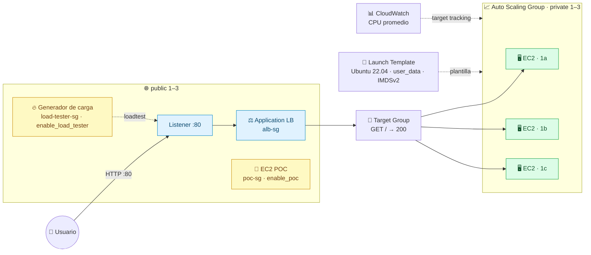
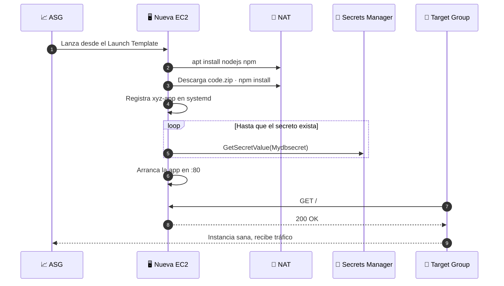

<div align="center">

# 🖥 Módulo `compute`

**El App Server detrás de un Application Load Balancer, en un Auto Scaling Group que crece con la demanda y se repara solo.**


[⬅ Volver al README principal](../../README.md)

</div>

---

## 🎯 Propósito

Corre la aplicación Node.js de registros estudiantiles y la mantiene **disponible y escalable**:

- ⚖️ El **ALB** reparte el tráfico entre instancias sanas de 3 zonas de disponibilidad.
- 📈 El **Auto Scaling Group** agrega instancias cuando sube la CPU y las quita cuando baja.
- 🛟 Si una instancia falla su *health check*, el ASG la **reemplaza automáticamente**.
- 🧪 Opcionalmente, una **EC2 única (POC)** para la Fase 2 del proyecto.
- 🔥 Opcionalmente, un **generador de carga** temporal para la Fase 4 (reemplaza a Cloud9).

Cubre las fases 2 y 4 del [`SPECS.md`](../../SPECS.md): *"Deploy a web application with the load distributed across multiple web servers"* e *"Implement high availability and scalability"*.

---

## 🗺 Cómo se conecta



---

## 📦 Recursos

| Archivo | Recurso | Detalle |
|---|---|---|
| `main.tf` | `data.aws_ami` | Última AMI de **Ubuntu 22.04 LTS** (Canonical). Se puede fijar con `ami_id` |
| `main.tf` | `data.aws_default_tags` | Copia los `default_tags` a instancias y volúmenes (el Launch Template no los hereda) |
| `poc.tf` | `aws_instance.poc` *(opcional)* | EC2 POC de la Fase 2 en `public 1`, con IP pública, MySQL local, `vockey` y `LabInstanceProfile`. Se activa con `enable_poc` |
| `launch_template.tf` | `aws_launch_template` | AMI Ubuntu, `instance_type`, `LabInstanceProfile`, `app-sg`, **IMDSv2 obligatorio**, sin IP pública, disco gp3 cifrado, *detailed monitoring*, `user_data` desde la plantilla |
| `alb.tf` | `aws_lb` | ALB *internet-facing* en public 1–3 con `alb-sg` y `drop_invalid_header_fields` |
| `alb.tf` | `aws_lb_target_group` | HTTP en `app_port`, *health check* `GET /` → `200`, *deregistration delay* de 30 s |
| `alb.tf` | `aws_lb_listener` | Puerto 80 → Target Group |
| `asg.tf` | `aws_autoscaling_group` | En private 1–3, ligado al Target Group, *health check* tipo **ELB** con periodo de gracia, *instance refresh* sin pérdida de capacidad (100 % / 200 %) al cambiar el Launch Template |
| `asg.tf` | `aws_autoscaling_policy` | **Target tracking** sobre `ASGAverageCPUUtilization` |
| `load_tester.tf` | `aws_instance.load_tester` *(opcional)* | EC2 temporal en `public 1` con `load-tester-sg` (de `security`) que corre Script-2 (`loadtest`) contra el ALB. Se activa con `enable_load_tester` |

> [!NOTE]
> Este módulo **no crea Security Groups**: todos (incluido `load-tester-sg`) vienen de `security` como entradas.

---

## 🧩 Lo que el código de la app impone

Revisamos `code.zip`. Estos detalles condicionan la infraestructura:

| En el código | Consecuencia |
|---|---|
| `config.js` lee el secreto **`Mydbsecret`** en **`us-east-1`**, ambos fijos | `secret_name` y `region` solo aceptan esos valores (validación). El módulo `database` debe crear el secreto con ese nombre y las llaves `user`, `password`, `host`, `db` |
| Si no encuentra el secreto, usa `localhost` / `nodeapp` / `student12` / `STUDENTS` | La POC funciona sin secreto con MySQL local. En el App Server, el `user_data` **espera a que el secreto exista** antes de arrancar la app; si no, la instancia parecería sana pero sin base de datos |
| La configuración se lee **solo al arrancar** | Si el secreto cambia, hay que reiniciar las instancias (`instance refresh` o terminar instancias) |
| `/students` abre una **conexión nueva a MySQL por petición** y no la cierra | El *health check* usa `/`, que no toca la base. La prueba de carga también usa `/` para no agotar las conexiones de `db.t3.micro` |
| Escucha en `APP_PORT` (80) | El servicio corre como usuario sin privilegios con `CAP_NET_BIND_SERVICE` |

---

## 🚀 Arranque de una instancia

Las instancias no se configuran a mano. Las plantillas de `templates/` se rellenan con `templatefile()` y registran la app como servicio **systemd** (`xyz-app`), que se reinicia sola si se cae.

| Plantilla | Quién la usa | Qué hace |
|---|---|---|
| [`user_data.sh.tftpl`](templates/user_data.sh.tftpl) | Launch Template (App Server) | Instala Node.js, descarga la app, **espera el secreto** y arranca `xyz-app` |
| [`poc_user_data.sh.tftpl`](templates/poc_user_data.sh.tftpl) | EC2 POC | Lo mismo más MySQL local (solo en `127.0.0.1`) con la base `STUDENTS` |
| [`load_tester_user_data.sh.tftpl`](templates/load_tester_user_data.sh.tftpl) | Generador de carga | Instala `loadtest@5.2.0`, espera a que el ALB responda `200` y corre la prueba |



**Variables que recibe la plantilla del App Server:**

| Variable | Origen | Ejemplo |
|---|---|---|
| `region` | Raíz | `us-east-1` |
| `secret_name` | Módulo `database` | `Mydbsecret` |
| `app_port` | Raíz | `80` |
| `app_code_url` | Default del módulo | URL de `code.zip` de AWS Academy |
| `app_dir` | Local del módulo | `/opt/xyz-app/resources/codebase_partner` |

> [!CAUTION]
> El `user_data` del App Server **nunca** recibe usuarios ni contraseñas. La app obtiene las credenciales de Secrets Manager en tiempo de ejecución, usando el rol de la instancia.

> [!TIP]
> Si una instancia nunca queda sana, entra por *EC2 Instance Connect* o revisa *Get system log* y busca en `/var/log/cloud-init-output.log` y `journalctl -u xyz-app`. `Esperando el secreto` significa que falta el secreto o la salida por el NAT. Si `apt` no avanza, revisa el ruteo (módulo `networking`).

---

## 📈 Escalado

| Parámetro | 🟢 dev | 🔴 prod |
|---|:--:|:--:|
| `instance_type` | `t3.micro` | `t3.small` |
| `asg_min` | 1 | 2 |
| `asg_desired` | 1 | 3 |
| `asg_max` | 2 | 6 |
| `cpu_target` | 70 % | 50 % |
| `health_check_grace_period` | 300 s | 300 s |

**Cómo decide el ASG:** CloudWatch calcula la CPU promedio del grupo. Si supera `cpu_target`, el ASG lanza instancias hasta acercarse al objetivo, sin pasar de `asg_max`. Cuando la carga baja, las retira gradualmente hasta `asg_min`. La evidencia de la prueba de carga va en [`docs/evidencias/`](../../docs/evidencias/).

> [!NOTE]
> `asg_desired` solo se usa **al crear** el ASG (`ignore_changes`). Después la capacidad la controla la política. Así, un `apply` en plena carga no regresa el grupo al valor inicial.

---

## 🧪 Fase 2 y migración (Fase 3)

1. En `dev.tfvars`: `enable_poc = true`. La app abre en `http://<poc_public_ip>` con la base local vacía. Agrega registros.
2. Cuando `database` haya creado RDS y `Mydbsecret`, entra a la POC con `vockey`. `security` debe permitir el 22 en `poc-sg` desde tu IP y el 3306 de `poc-sg` hacia `db-sg`.
   ```bash
   ssh -i labsuser.pem ubuntu@<poc_public_ip>
   ```
3. Ya en la POC, ejecuta la versión adaptada de Script-3. El *dump* se hace localmente en lugar de desde Cloud9:
   ```bash
   sudo mysqldump --databases STUDENTS --no-tablespaces > data.sql
   mysql -h <db_endpoint> -u nodeapp -p STUDENTS < data.sql
   ```
4. Verifica los registros en `http://<alb_dns_name>/students` y desactiva la POC: `enable_poc = false`.

> [!WARNING]
> La POC tiene `LabInstanceProfile`. Si **se reinicia** cuando `Mydbsecret` ya existe, la app se conectará a RDS en lugar de a su MySQL local. Los datos locales no se pierden; basta con no reiniciarla hasta migrar.

---

## 🔥 Prueba de carga (sin Cloud9)

1. En `dev.tfvars`: `enable_load_tester = true` (lo reciben `security` y `compute`). Para entrar por SSH, en `security`: `load_tester_ssh_cidrs = ["<tu-ip>/32"]`.
2. Al arrancar, la instancia espera a que el ALB responda `200` y corre:
   `loadtest --rps 1000 -c 500 -k -t 600 http://<alb_dns_name>/`
3. Observa el escalado en la consola (ASG → *Activity* y *Monitoring*) o con los comandos de abajo. Los resultados quedan en `/var/log/xyz-loadtest.log` y en *EC2 → Get system log*.
4. Para repetirla por SSH: `sudo systemctl start xyz-loadtest`.
5. Al terminar: `enable_load_tester = false`.

Los parámetros se cambian con `load_test = { rps = 1000, concurrency = 500, duration_seconds = 600, path = "/" }`.

---

## 🔌 Contrato

### Entradas (`variables.tf`)

| Variable | Tipo | Viene de | Default |
|---|---|---|---|
| `environment` | `string` | Raíz | — |
| `vpc_id` | `string` | networking | — |
| `public_subnet_ids` | `list(string)` | networking | — |
| `app_subnet_ids` | `list(string)` | networking | — |
| `alb_sg_id` | `string` | security | — |
| `app_sg_id` | `string` | security | — |
| `poc_sg_id` | `string` | security | `null` (obligatorio con `enable_poc`) |
| `instance_profile_name` | `string` | security | — |
| `secret_name` | `string` | database | `Mydbsecret` |
| `region` | `string` | Raíz | `us-east-1` |
| `app_port` | `number` | Raíz | `80` |
| `instance_type` | `string` | `*.tfvars` | `t3.micro` |
| `asg_min` · `asg_desired` · `asg_max` | `number` | `*.tfvars` | 1 · 1 · 2 |
| `cpu_target` | `number` | `*.tfvars` | `70` |
| `health_check_path` | `string` | Módulo | `/` |
| `health_check_grace_period` | `number` | Módulo | `300` |
| `enable_poc` | `bool` | `*.tfvars` | `false` |
| `poc_instance_type` · `poc_key_name` | `string` | Módulo | `t3.micro` · `vockey` |
| `enable_load_tester` | `bool` | `*.tfvars` | `false` |
| `load_tester_sg_id` | `string` | security | `null` (obligatorio con `enable_load_tester`) |
| `load_tester_instance_type` · `load_tester_key_name` | `string` | Módulo | `t3.micro` · `vockey` |
| `load_test` | `object` | Módulo | Script-2, 600 s, ruta `/` |
| `ami_id` · `app_code_url` · `root_volume_size` | | Módulo | `null` · `code.zip` de Academy · `10` |

### Salidas (`outputs.tf`)

| Output | Lo consume |
|---|---|
| `alb_dns_name` · `alb_url` | Outputs raíz · `smoke-test.sh` · prueba de carga |
| `target_group_arn` | Diagnóstico |
| `asg_name` | Evidencias de escalado |
| `launch_template_id` · `launch_template_latest_version` · `ami_id` | Diagnóstico |
| `poc_public_ip` · `poc_private_ip` · `poc_instance_id` | Prueba de la Fase 2 · migración de datos |
| `load_tester_instance_id` · `load_tester_public_ip` | Prueba de carga |

---

## ✅ Criterios de aceptación

- [ ] **Fase 2:** la app abre por la IP pública de la POC y el CRUD funciona.
- [ ] Una instancia nueva queda **sana** en el Target Group sin intervención manual.
- [ ] La app abre por el **DNS del ALB** y el CRUD funciona.
- [ ] Las instancias **no** tienen IP pública.
- [ ] Al terminar una instancia a mano, el ALB deja de enviarle tráfico y el ASG lanza un reemplazo.
- [ ] Durante la prueba de carga, el ASG **escala hacia arriba** y luego **regresa** al mínimo.

### Cómo verificar

```bash
# Pruebas del módulo (sin AWS, con mock provider)
cd terraform/compute && terraform init -backend=false && terraform test

# URL de la app
terraform -chdir=terraform output -raw alb_dns_name

# Estado de las instancias en el Target Group
aws elbv2 describe-target-health --target-group-arn <arn> \
  --query "TargetHealthDescriptions[].{Id:Target.Id,Estado:TargetHealth.State}"

# Actividad de escalado
aws autoscaling describe-scaling-activities --auto-scaling-group-name <asg> --max-items 10
```

---

## 🤝 Puntos de integración

| Con | Qué se acuerda |
|---|---|
| 🛡 `security` | `app_port = 80` (alb-sg → app-sg). *Health check* en `/`. `poc-sg`: 80 desde internet, 22 desde la IP del operador. `poc-sg → db-sg :3306` temporal para la migración. `load-tester-sg`: salida 80/443 y 22 desde `load_tester_ssh_cidrs`. `enable_poc` y `enable_load_tester` deben ser **el mismo valor** en ambos módulos |
| 🌐 `networking` | Las instancias necesitan el NAT para el `user_data` (apt, npm, `code.zip`) y para Secrets Manager en dev. `vpc_id` lo usa el Target Group |
| 🗄 `database` | Secreto **`Mydbsecret`** con llaves `user`, `password`, `host` (sin puerto) y `db` (`STUDENTS`). Usuario `nodeapp`. La POC se mantiene viva hasta que la migración termine |
