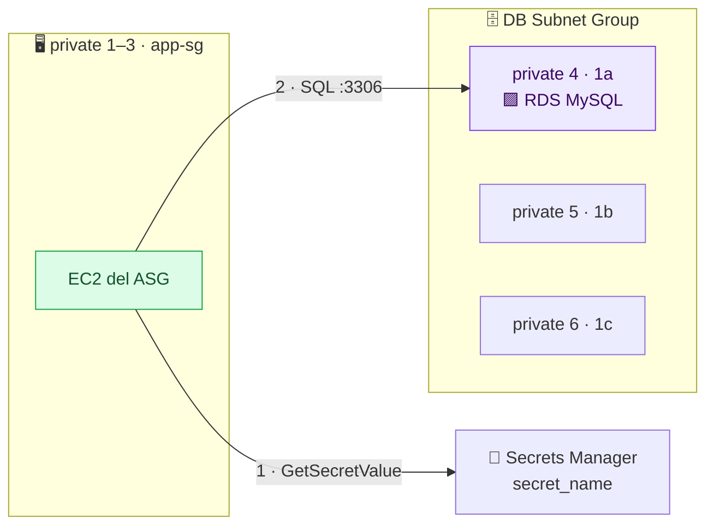
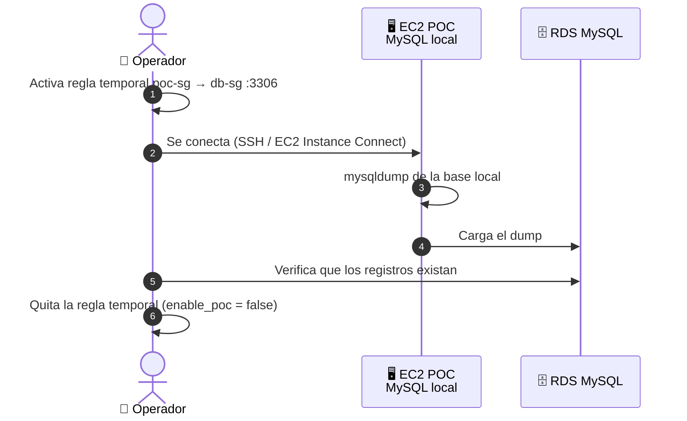

<div align="center">

# 🗄 Módulo `database`

**La capa de datos: RDS MySQL en subnets privadas sin acceso a internet, con credenciales guardadas en Secrets Manager.**


[⬅ Volver al README principal](../../README.md)

</div>

---

## 🎯 Propósito

Separa la base de datos del servidor web y la lleva a un **servicio administrado**. Así la aplicación puede escalar horizontalmente sin perder datos, y AWS se encarga de parches, respaldos y almacenamiento.

Cubre la fase 3 del [`SPECS.md`](../../SPECS.md):

- 🗄 *"Create an Amazon RDS database that runs a MySQL engine."*
- 🔒 *"The database is secured and can't be accessed directly from public networks."*
- 🔑 *"The database credentials aren't hardcoded into the web application."*
- 🚚 *"Migrate the data from the original database to the new Amazon RDS database."*

---

## 🗺 Ubicación



> [!NOTE]
> El SPECS pide la base **en una sola AZ** (`private 4`). Aun así, RDS exige que el DB Subnet Group abarque **al menos 2 AZ**, por eso incluye `private 5` y `private 6`: quedan listas por si en el futuro se activa Multi-AZ.

---

## 📦 Recursos

| Recurso | Detalle |
|---|---|
| `aws_db_subnet_group` | private 4–6 |
| `aws_db_instance` | MySQL, `db.t3.micro`, **Single-AZ**, `publicly_accessible = false`, `db-sg`, **sin enhanced monitoring**, almacenamiento cifrado |
| `random_password` | Contraseña generada por Terraform (si se elige la opción A, ver abajo) |
| `aws_secretsmanager_secret` | Contenedor del secreto con el nombre que espera la app |
| `aws_secretsmanager_secret_version` | El JSON con host, usuario, contraseña y nombre de la base |

---

## 🔐 El secreto

La aplicación lee el secreto **tal cual lo crea Script-1** del curso, así que el **nombre** y el **formato JSON** deben coincidir exactamente. Revisa `scripts/cloud9-scripts.yml` antes de implementar.

```json
{
  "user": "nodeapp",
  "password": "••••••••••••",
  "host": "xyz-dev-db.xxxxxxxx.us-east-1.rds.amazonaws.com",
  "db": "STUDENTS"
}
```

<sub>Ejemplo ilustrativo: las llaves reales salen de Script-1.</sub>

### ¿Quién crea el secreto?

| | Opción A · Terraform | Opción B · Script-1 |
|---|---|---|
| **Cómo** | `random_password` + `aws_secretsmanager_secret_version` con el endpoint de RDS | Se corre Script-1 con la AWS CLI; Terraform solo lo lee con `data` |
| ✅ Ventaja | Todo reproducible desde el pipeline, sin pasos manuales | La contraseña no pasa por el estado de Terraform |
| ⚠️ Desventaja | La contraseña queda en el `tfstate`: el bucket **debe** estar cifrado y privado | Un paso manual por ambiente; hay que coordinarlo con el primer apply |
| **Recomendación** | ⭐ Preferida para dev/prod efímeros | Útil si se quiere replicar el laboratorio al pie de la letra |

---

## 🚚 Migración de datos (Fase 3)

Los registros que existen en la base local de la EC2 POC se pasan a RDS con **Script-3** del curso:



> [!WARNING]
> La regla `poc-sg → db-sg` es **temporal**. Terminada la migración, se desactiva `enable_poc` y se confirma en el `plan` que la regla desaparece.

---

## 🔌 Contrato

### Entradas (`variables.tf`)

| Variable | Tipo | Viene de |
|---|---|---|
| `environment` | `string` | Raíz |
| `data_subnet_ids` | `list(string)` | networking |
| `db_sg_id` | `string` | security |
| `db_instance_class` | `string` | `*.tfvars` |
| `db_name` | `string` | Raíz (debe coincidir con Script-1) |
| `db_username` | `string` | Raíz |
| `secret_name` | `string` | Raíz (debe coincidir con Script-1) |
| `db_backup_retention_days` | `number` | `*.tfvars` |
| `db_deletion_protection` | `bool` | `*.tfvars` |
| `db_skip_final_snapshot` | `bool` | `*.tfvars` |

### Salidas (`outputs.tf`)

| Output | Lo consume |
|---|---|
| `db_endpoint` | Secreto · outputs raíz · migración |
| `db_name` | Migración |
| `secret_name` | compute (`user_data`) |
| `secret_arn` | Diagnóstico |

---

## 🌗 Diferencias entre ambientes

| | 🟢 dev | 🔴 prod |
|---|:--:|:--:|
| `db_instance_class` | `db.t3.micro` | `db.t3.micro` |
| Respaldos automáticos | 0 días | 7 días |
| `deletion_protection` | ❌ | ✅ |
| Snapshot final al destruir | ❌ | ✅ |
| Multi-AZ | ❌ | ❌ (lo indica el SPECS) |

> [!CAUTION]
> Cambiar ciertos atributos (identificador, engine, subnet group) **recrea** la base y **borra los datos**. Antes de aprobar un PR, busca `-/+` sobre `aws_db_instance` en el plan. Cerca de la entrega, considera `lifecycle { prevent_destroy = true }` en prod.

---

## ✅ Criterios de aceptación

- [ ] RDS MySQL corre en `private 4` con `publicly_accessible = false`.
- [ ] Enhanced monitoring **desactivado**.
- [ ] Solo `app-sg` (y temporalmente `poc-sg`) puede conectarse al 3306.
- [ ] El secreto tiene **el mismo nombre y formato** que espera la aplicación.
- [ ] La app servida desde el ALB muestra los registros migrados desde la POC.
- [ ] El CRUD completo funciona contra RDS.

### Cómo verificar

```bash
# La base no es pública
aws rds describe-db-instances \
  --query "DBInstances[].{Id:DBInstanceIdentifier,Publica:PubliclyAccessible,AZ:AvailabilityZone}"

# El secreto existe y tiene el formato correcto (desde una EC2 con LabInstanceProfile)
aws secretsmanager get-secret-value --secret-id <secret_name> --query SecretString --output text
```

---

## 🤝 Puntos de integración

| Con | Qué se acuerda |
|---|---|
| 🛡 `security` | `db_sg_id` y cuándo se quita la regla temporal de la POC |
| 🖥 `compute` | El `secret_name` exacto y que la POC siga viva hasta terminar la migración |
| 🌐 `networking` | `data_subnet_ids` en al menos 2 AZ |
