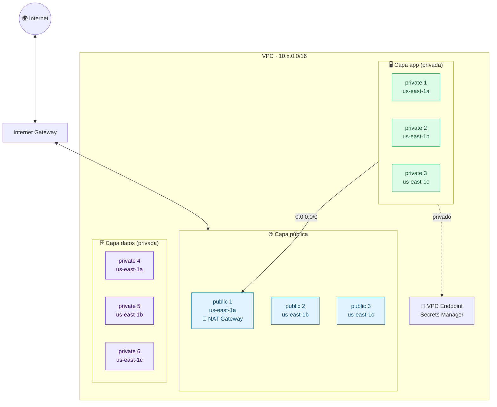

<div align="center">

# 🌐 Módulo `networking`

**La red de la aplicación: VPC en 3 zonas de disponibilidad, subnets por capa, salida a internet controlada y acceso privado a Secrets Manager.**


[⬅ Volver al README principal](../../README.md)

</div>

---

## 🎯 Propósito

Este módulo construye la red sobre la que vive todo lo demás. Separa la aplicación en **tres capas de subnets** (pública, app y datos), cada una con su propio nivel de exposición a internet:

- **Pública:** lo único que se ve desde internet (el ALB) y el NAT Gateway.
- **App:** las instancias EC2. Pueden **salir** a internet (para instalar paquetes) pero nadie puede **entrar** directamente.
- **Datos:** la base de datos. **No tiene ninguna ruta a internet.**

Cubre los requisitos del [`SPECS.md`](../../SPECS.md): *"Create a virtual network that is configured appropriately to host a web application that is publicly accessible and secure"* y *"private subnets in a minimum of two Availability Zones"*.

---

## 🗺 Topología



---

## 📦 Recursos

| Recurso | Cantidad | Detalle |
|---|:--:|---|
| `aws_vpc` | 1 | DNS hostnames y DNS support activados (los necesita el endpoint privado) |
| `aws_subnet` | 9 | 3 públicas, 3 de app, 3 de datos; una por AZ en cada capa |
| `aws_internet_gateway` | 1 | Entrada y salida de la capa pública |
| `aws_eip` | 1 | IP fija del NAT Gateway |
| `aws_nat_gateway` | 1 | En `public 1`. **Uno solo** para ahorrar costo |
| `aws_route_table` | 3 | Pública, app y datos |
| `aws_route_table_association` | 9 | Cada subnet con su tabla |
| `aws_vpc_endpoint` | 0 – 1 | Interface Endpoint de Secrets Manager, condicionado a `enable_secrets_endpoint` |

### Plan de direccionamiento

| Subnet | AZ | 🟢 dev | 🔴 prod | Capa |
|---|---|---|---|---|
| `public 1` | us-east-1a | `10.10.1.0/24` | `10.20.1.0/24` | 🌐 Pública |
| `public 2` | us-east-1b | `10.10.2.0/24` | `10.20.2.0/24` | 🌐 Pública |
| `public 3` | us-east-1c | `10.10.3.0/24` | `10.20.3.0/24` | 🌐 Pública |
| `private 1` | us-east-1a | `10.10.11.0/24` | `10.20.11.0/24` | 🖥 App |
| `private 2` | us-east-1b | `10.10.12.0/24` | `10.20.12.0/24` | 🖥 App |
| `private 3` | us-east-1c | `10.10.13.0/24` | `10.20.13.0/24` | 🖥 App |
| `private 4` | us-east-1a | `10.10.21.0/24` | `10.20.21.0/24` | 🗄 Datos |
| `private 5` | us-east-1b | `10.10.22.0/24` | `10.20.22.0/24` | 🗄 Datos |
| `private 6` | us-east-1c | `10.10.23.0/24` | `10.20.23.0/24` | 🗄 Datos |

> [!TIP]
> El tercer octeto indica la capa: `1–3` pública, `11–13` app, `21–23` datos. Así una IP basta para saber de qué capa viene el tráfico.

### Tablas de ruteo

| Tabla | Destino | Target | Asociada a |
|---|---|---|---|
| 🌐 `public` | `0.0.0.0/0` | Internet Gateway | public 1–3 |
| 🖥 `app` | `0.0.0.0/0` | NAT Gateway | private 1–3 |
| 🗄 `data` | *(solo la ruta local de la VPC)* | — | private 4–6 |

---

## 🔌 Contrato

### Entradas (`variables.tf`)

| Variable | Tipo | Descripción |
|---|---|---|
| `environment` | `string` | `dev` o `prod`; se usa en nombres y tags |
| `vpc_cidr` | `string` | Bloque CIDR de la VPC |
| `azs` | `list(string)` | Zonas de disponibilidad: `["us-east-1a", "us-east-1b", "us-east-1c"]` |
| `public_subnet_cidrs` | `list(string)` | CIDRs de public 1–3 |
| `app_subnet_cidrs` | `list(string)` | CIDRs de private 1–3 |
| `data_subnet_cidrs` | `list(string)` | CIDRs de private 4–6 |
| `enable_secrets_endpoint` | `bool` | Crea o no el VPC Endpoint de Secrets Manager |
| `endpoint_sg_id` | `string` | SG del endpoint (viene de `security`) |

### Salidas (`outputs.tf`)

| Output | Lo consume |
|---|---|
| `vpc_id` | security · compute · database |
| `vpc_cidr` | security |
| `public_subnet_ids` | compute (ALB, POC) |
| `app_subnet_ids` | compute (ASG) |
| `data_subnet_ids` | database (DB Subnet Group) |
| `nat_gateway_id` | outputs raíz / diagnóstico |

---

## 🌗 Diferencias entre ambientes

| | 🟢 dev | 🔴 prod |
|---|---|---|
| CIDR de la VPC | `10.10.0.0/16` | `10.20.0.0/16` |
| VPC Endpoint | ❌ Las instancias obtienen el secreto por el NAT | ✅ El secreto viaja por la red privada de AWS |
| NAT Gateway | 1 | 1 |

---

## 💰 Costo

| Recurso | Cobra por | Nota |
|---|---|---|
| NAT Gateway | Hora + GB procesado | El recurso más caro del módulo. Por eso hay **uno solo** y no uno por AZ |
| Elastic IP | Hora mientras exista | Va asociada al NAT |
| VPC Endpoint (Interface) | Hora por AZ + GB | Solo en prod |
| VPC, subnets, rutas, IGW | — | Sin costo |

> [!WARNING]
> Con un solo NAT, si `us-east-1a` falla, las instancias de las otras AZ pierden la salida a internet. Las que ya están corriendo siguen sirviendo tráfico (el ALB llega por la red interna), pero no podrían arrancar instancias nuevas que necesiten instalar paquetes. Es un trade-off aceptado para la POC.

---

## ✅ Criterios de aceptación

- [ ] Las 9 subnets existen, una por AZ en cada capa, sin traslape de CIDRs.
- [ ] Las subnets públicas tienen ruta `0.0.0.0/0 → IGW`.
- [ ] Las subnets de app tienen ruta `0.0.0.0/0 → NAT`.
- [ ] Las subnets de datos **no** tienen ninguna ruta a internet.
- [ ] Desde una EC2 en `private 1`, `curl https://ubuntu.com` funciona (salida por el NAT).
- [ ] En prod, desde una EC2 privada, `aws secretsmanager get-secret-value` resuelve a una IP privada del endpoint.

### Cómo verificar

```bash
# Rutas de cada tabla
aws ec2 describe-route-tables \
  --filters "Name=tag:Environment,Values=dev" \
  --query "RouteTables[].{Tabla:Tags[?Key=='Name']|[0].Value,Rutas:Routes[].DestinationCidrBlock}"

# El endpoint privado resuelve a una IP de la VPC
nslookup secretsmanager.us-east-1.amazonaws.com
```

---

## 🤝 Puntos de integración

| Con | Qué se acuerda |
|---|---|
| 🛡 `security` | `endpoint_sg_id` debe permitir 443 desde `app-sg`, si no, las instancias no obtienen el secreto. *Terraform resuelve dependencias valor por valor, no módulo por módulo: `security` usa `vpc_id` y `networking` usa `endpoint_sg_id` sin crear un ciclo.* |
| 🖥 `compute` | El `user_data` necesita el NAT para instalar Node.js. Si el arranque falla, revisar ruteo **antes** que el código |
| 🗄 `database` | El DB Subnet Group usa `data_subnet_ids` (mínimo 2 AZ, lo exige RDS) |
