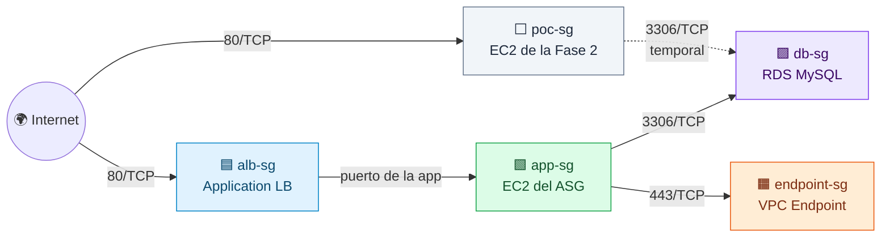
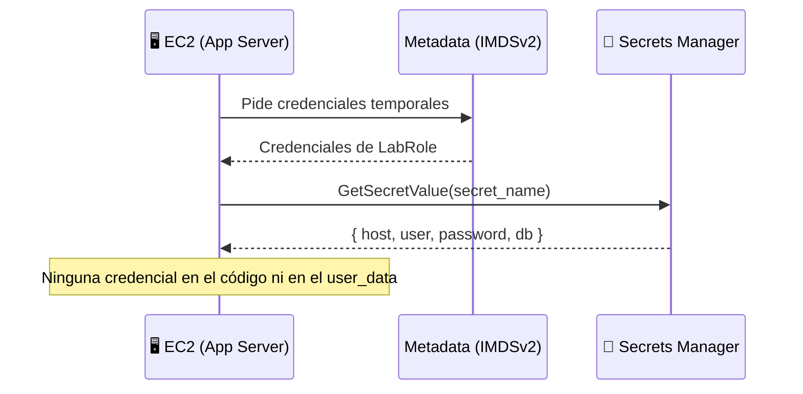

<div align="center">

# 🛡 Módulo `security`

**Security Groups encadenados por referencia y acceso al perfil IAM del laboratorio: cada capa solo habla con la que le corresponde, por el puerto que le corresponde.**


[⬅ Volver al README principal](../../README.md)

</div>

---

## 🎯 Propósito

Centraliza **todas las reglas de acceso de red** y la **identidad de las instancias**. Los Security Groups se referencian entre sí (`alb-sg` → `app-sg` → `db-sg`). Si cada uno viviera en el módulo de su recurso, `compute` y `database` dependerían uno del otro. Tenerlos juntos aquí mantiene las dependencias en un solo sentido.

Cubre estos requisitos del [`SPECS.md`](../../SPECS.md):

- 🔒 *"The database is secured and can't be accessed directly from public networks."*
- 🔒 *"The web servers and database can be accessed only over the appropriate ports."*
- 🔒 *"Allow only the web application to access the database."*
- 🔑 *"Attach the existing LabInstanceProfile so that it can fetch the secret securely."*

---

## 🔗 Cadena de confianza



> [!IMPORTANT]
> Las reglas usan **`referenced_security_group_id`**, no rangos CIDR. Una instancia nueva del ASG queda autorizada en cuanto recibe `app-sg`, sin importar su IP, y nada fuera de ese SG puede llegar a la base de datos aunque esté en la misma VPC.

---

## 📋 Matriz de puertos

### Entrada (ingress)

| Security Group | Puerto | Protocolo | Origen | Por qué |
|---|:--:|:--:|---|---|
| 🟦 `alb-sg` | 80 | TCP | `0.0.0.0/0` | La app es pública y sin HTTPS (permitido por el SPECS) |
| 🟩 `app-sg` | puerto de la app¹ | TCP | `alb-sg` | Solo el ALB llega a las instancias |
| 🟪 `db-sg` | 3306 | TCP | `app-sg` | Solo la aplicación habla con la base |
| 🟪 `db-sg` | 3306 | TCP | `poc-sg` | ⏳ **Temporal**, solo durante la migración de datos |
| 🟧 `endpoint-sg` | 443 | TCP | `app-sg` | Llamadas a Secrets Manager por la red privada |
| ⬜ `poc-sg` | 80 | TCP | `0.0.0.0/0` | Prueba de la Fase 2 por IP pública |

<sub>¹ Confirmar en el código del App Server; en el laboratorio suele ser `80`.</sub>

### Salida (egress)

| Security Group | Destino | Por qué |
|---|---|---|
| 🟦 `alb-sg` | `app-sg` en el puerto de la app | Reenviar peticiones y hacer *health checks* |
| 🟩 `app-sg` | `0.0.0.0/0` | Paquetes del sistema y de Node durante el `user_data` (sale por el NAT) |
| 🟪 `db-sg` | — | La base no inicia conexiones |
| 🟧 `endpoint-sg` | — | Solo responde |

---

## 🔑 Identidad: LabRole y LabInstanceProfile

AWS Academy **no permite crear roles IAM**. Las instancias usan el perfil que ya existe en la cuenta, y Terraform solo lo **lee**:

```hcl
data "aws_iam_instance_profile" "lab" {
  name = "LabInstanceProfile"
}
```



---

## 📦 Recursos

| Recurso | Cantidad | Detalle |
|---|:--:|---|
| `aws_security_group` | 5 | `alb-sg`, `app-sg`, `db-sg`, `endpoint-sg`, `poc-sg` |
| `aws_vpc_security_group_ingress_rule` | ~6 | Una regla por fila de la matriz |
| `aws_vpc_security_group_egress_rule` | ~2 | Solo donde hace falta salida |
| `data.aws_iam_instance_profile` | 1 | `LabInstanceProfile` (solo lectura) |
| `data.aws_iam_role` | 1 | `LabRole` (solo lectura) |

> [!TIP]
> Usar `aws_vpc_security_group_ingress_rule` / `egress_rule` (un recurso por regla) en lugar de bloques `ingress {}` dentro del SG evita que Terraform reescriba todas las reglas cuando cambia una sola.

---

## 🔌 Contrato

### Entradas (`variables.tf`)

| Variable | Tipo | Descripción |
|---|---|---|
| `environment` | `string` | `dev` o `prod` |
| `vpc_id` | `string` | VPC donde se crean los SGs (viene de `networking`) |
| `app_port` | `number` | Puerto en el que escucha el App Server |
| `enable_poc` | `bool` | Crea o no `poc-sg` y la regla temporal hacia `db-sg` |

### Salidas (`outputs.tf`)

| Output | Lo consume |
|---|---|
| `alb_sg_id` | compute (ALB) |
| `app_sg_id` | compute (Launch Template) |
| `db_sg_id` | database (RDS) |
| `endpoint_sg_id` | networking (VPC Endpoint) |
| `poc_sg_id` | compute (EC2 POC) |
| `instance_profile_name` | compute (Launch Template, POC) |

---

## 🌗 Diferencias entre ambientes

| | 🟢 dev | 🔴 prod |
|---|---|---|
| `poc-sg` y regla temporal | ✅ Mientras dure la Fase 2 y la migración | ❌ |
| `endpoint-sg` | Se crea, pero sin endpoint que lo use | ✅ Lo usa el VPC Endpoint |
| Reglas de la cadena principal | Idénticas | Idénticas |

---

## 🛡 Seguridad en el pipeline

`ci.yml` corre **Checkov** sobre `terraform/` en cada PR y falla ante hallazgos altos. Los hallazgos que son limitaciones del laboratorio se suprimen **en el código y con justificación**:

```hcl
resource "aws_lb" "this" {
  #checkov:skip=CKV_AWS_2:El SPECS no requiere HTTPS para la POC
  ...
}
```

| Hallazgo esperado | Motivo de la excepción |
|---|---|
| Listener HTTP sin TLS | El SPECS no requiere HTTPS ni dominio |
| `alb-sg` abierto a `0.0.0.0/0` | La app debe ser pública y sin autenticación |
| Sin Multi-AZ en RDS | El SPECS pide la base en una sola AZ |
| Sin logs de flujo de la VPC | Fuera de alcance y con costo extra |

---

## ✅ Criterios de aceptación

- [ ] Ninguna regla abre 3306 a `0.0.0.0/0`.
- [ ] `app-sg` solo acepta tráfico desde `alb-sg`.
- [ ] `db-sg` solo acepta tráfico desde `app-sg` (y temporalmente desde `poc-sg`).
- [ ] Una EC2 con `LabInstanceProfile` puede leer el secreto con `aws secretsmanager get-secret-value`.
- [ ] La regla temporal `poc-sg → db-sg` **ya no existe** al terminar la migración.
- [ ] Checkov pasa sin hallazgos altos sin justificar.

### Cómo verificar

```bash
# Ninguna regla con 3306 abierta a internet
aws ec2 describe-security-groups \
  --filters "Name=ip-permission.from-port,Values=3306" "Name=ip-permission.cidr,Values=0.0.0.0/0" \
  --query "SecurityGroups[].GroupName"
# → debe regresar []

# Escaneo local
checkov -d terraform/
```

---

## 🤝 Puntos de integración

| Con | Qué se acuerda |
|---|---|
| 🌐 `networking` | `endpoint_sg_id` para el VPC Endpoint |
| 🖥 `compute` | El **puerto de la app** (`app_port`) y la ruta del *health check* |
| 🗄 `database` | Avisar cuándo termina la migración para quitar la regla temporal (`enable_poc = false`) |
